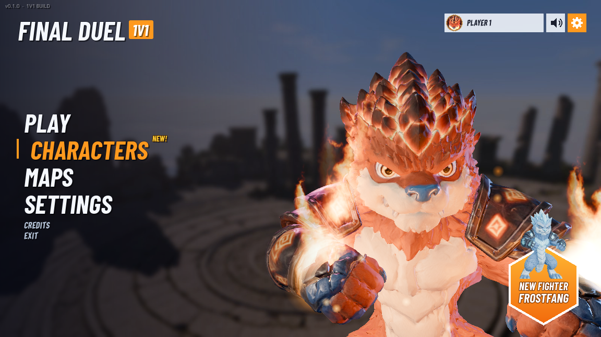

# FINAL DUEL

เกมต่อสู้ 3 มิติแบบ **1v1 สำหรับผู้เล่นสองคนบนเครื่องเดียวกัน** พัฒนาด้วย Godot และ GDScript ในรายวิชา **CP410844 Computer Game Development** ภาคการศึกษาต้น ปีการศึกษา 2569

เลือกผู้พิทักษ์ที่ชอบ ดวลด้วยคอมโบ ต่อสู้กลางอากาศ และใช้ท่าไม้ตายประจำตัวเพื่อเอาชนะคู่ต่อสู้

**[เล่นเกมบนเว็บ](https://sitthiphongn-sudo.github.io/final-duel/)**



## แนวคิดของเกม

FINAL DUEL ผสมการต่อสู้ในพื้นที่สามมิติกับแอ็กชันสไตล์อนิเมะ โดยมี Jump Force เป็นแรงบันดาลใจด้านการเคลื่อนที่ การเชื่อมคอมโบ และท่าไม้ตายพร้อมคัตซีน

โลกของเกมตั้งอยู่รอบวิหารโบราณที่ลอยเหนือทะเลเมฆ เหล่าผู้พิทักษ์มีความเชื่อในการปกป้องโลกต่างกัน เมื่อเกิดความขัดแย้ง พวกเขาจึงกลับมาตัดสินกันบนลานประลองแบบตัวต่อตัว

## ระบบหลัก

- ผู้เล่นสองคนต่อสู้บนเครื่องเดียวกัน ผ่านคีย์บอร์ดหรือจอย
- ตัวละคร 4 ตัว พร้อมเอฟเฟกต์และท่าไม้ตายเฉพาะตัว
- สนามประลอง 2 แห่ง
- คอมโบ 5 จังหวะ การโจมตีกลางอากาศ และท่าทุบลงพื้น
- บล็อก แดช และวิ่งเพื่อจัดระยะและสร้างจังหวะโจมตี
- เกจ HP, Stamina และเกจท่าไม้ตาย
- ระบบ K.O. คะแนนชนะ และเริ่มยกใหม่
- เมนูพักเกม การตั้งค่าเสียง และกราฟิก LOW / MEDIUM / HIGH
- กล้องสั่น การหยุดภาพชั่วขณะ และเอฟเฟกต์กระแทกพื้น

## ตัวละคร

| ตัวละคร | ลักษณะ | HP | ATK พื้นฐาน | ท่าไม้ตาย |
| --- | --- | ---: | ---: | --- |
| **EMBERCLAW** | ผู้พิทักษ์แห่งเปลวไฟ | 2,000 | 23 | Inferno Rush |
| **FROSTFANG** | ผู้พิทักษ์แห่งธารน้ำแข็ง | 2,200 | 21 | Absolute Zero Rush |
| **KING DUCK** | ราชาเป็ดผู้ใช้พลังลม | 2,100 | 22 | Golden Decree |
| **KARASU** | นินจาอีกาผู้ใช้ดาบและเงา | 2,000 | 24 | Crimson Moon Slash |

ATK เป็นค่าพลังโจมตีพื้นฐาน ความเสียหายจริงขึ้นอยู่กับท่าและสถานะระหว่างการต่อสู้

## สนามประลอง

| สนาม | รายละเอียด |
| --- | --- |
| **Skyborne Ruins** | ลานหินวงกลมบนซากวิหารลอยฟ้าเหนือทะเลเมฆ |
| **Colosseum Yard** | ลานประลองล้อมด้วยกำแพงหิน ประกอบจากชุด Kenney Mini Arena |

## วิธีเล่น

1. เลือกสนามจากเมนู **MAPS**
2. กด **PLAY** แล้วเลือกตัวละครของ P1 และ P2
3. รอหน้า **VS** เตรียมฉากต่อสู้
4. โจมตีเพื่อลด HP ของคู่ต่อสู้ให้หมด
5. เมื่อเกิด **K.O.** ระบบจะประกาศผู้ชนะ เพิ่มคะแนน และเริ่มยกใหม่

### เกจระหว่างต่อสู้

| เกจ | การใช้งาน |
| --- | --- |
| **HP** | พลังชีวิต เมื่อหมดจะแพ้ยก |
| **Stamina** | สูงสุด 100 ใช้แดชครั้งละ 25 และฟื้นกลับอัตโนมัติหลังหยุดใช้งาน |
| **Ultimate** | สะสมจากการโจมตี เมื่อเต็ม 100 จึงเริ่มใช้ท่าไม้ตายได้ในสถานะที่เหมาะสม |

## ปุ่มควบคุม

### คีย์บอร์ด

| การกระทำ | ผู้เล่น 1 | ผู้เล่น 2 |
| --- | --- | --- |
| เคลื่อนที่ | W / A / S / D | ปุ่มลูกศร |
| กระโดด | Space | Numpad 0 |
| โจมตี | J | Numpad 1 |
| เตะ | K | Numpad 2 |
| บล็อกค้าง | L | Numpad 3 |
| แดช | Q | Numpad 4 |
| ท่าไม้ตาย | R | Numpad 5 |
| วิ่ง | Left Shift | Numpad Enter |
| พักเกม | Esc | Esc |

**ปุ่มทางเลือกสำหรับผู้เล่น 2 เมื่อไม่มี Numpad**

| การกระทำ | ปุ่มทางเลือก |
| --- | --- |
| กระโดด | Right Ctrl |
| โจมตี | `,` |
| เตะ | `.` |
| บล็อกค้าง | `/` |
| แดช | `;` |
| ท่าไม้ตาย | `'` |
| วิ่ง | Right Shift |

### จอย

ใช้ชื่อปุ่มตามรูปแบบ Xbox โดยจอยตัวแรกควบคุม P1 และตัวที่สองควบคุม P2

| การกระทำ | ปุ่ม |
| --- | --- |
| เคลื่อนที่ | Left Stick / D-pad |
| กระโดด | A |
| โจมตี | X |
| เตะ | Y |
| แดช | B |
| บล็อกค้าง | RB |
| วิ่ง | LB |
| ท่าไม้ตาย | RT |

## เปิดโปรเจกต์เพื่อพัฒนา

### เครื่องมือ

- Godot รุ่นที่รองรับโปรเจกต์นี้ โดย `project.godot` ระบุเวอร์ชัน **4.7** และ **GL Compatibility**
- Git และ Git LFS สำหรับดาวน์โหลดโมเดล `.glb`
- Export Templates ของ Godot รุ่นเดียวกับ Editor หากต้องการส่งออกเกม

### ขั้นตอน

```bash
git lfs install
git clone https://github.com/sitthiphongn-sudo/final-duel.git
cd final-duel
git lfs pull
```

1. เปิด Godot Project Manager แล้วเลือก **Import**
2. เลือกไฟล์ `project.godot` ในโฟลเดอร์โปรเจกต์
3. รอให้ Editor นำเข้า Asset ให้เสร็จ
4. กด **F5** เพื่อรันเกมจากฉากเริ่มต้น

ไฟล์ `.glb` ใช้ Git LFS หากโมเดลหายหรือมีขนาดเพียงไม่กี่ร้อยไบต์ ให้ตรวจว่าได้ติดตั้ง Git LFS และรัน `git lfs pull` แล้ว

## โครงสร้างสำคัญ

| ตำแหน่ง | หน้าที่ |
| --- | --- |
| `scenes/` | ฉากเริ่มต้น เมนู เลือกตัวละคร และฉากต่อสู้ |
| `scripts/game_state.gd` | ข้อมูลตัวละคร สนาม ปุ่มควบคุม และการตั้งค่า |
| `scripts/player.gd` | การเคลื่อนที่และระบบต่อสู้ของนักสู้ |
| `scripts/main.gd` | สนาม การจบยก เริ่มยกใหม่ และพักเกม |
| `scripts/fight_camera.gd` | กล้องติดตามนักสู้ทั้งสอง |
| `scripts/ultimate*.gd` | ท่าไม้ตายและคัตซีน |
| `scripts/hud.gd` | ส่วนแสดงสถานะระหว่างเล่น |
| `lite/` | ทรัพยากรเวอร์ชันเบาที่ใช้ในเกม |
| `tools/` | สคริปต์เตรียม Asset เวอร์ชันเบา |
| `ui/`, `vfx/`, `sounds/`, `voice/` | ภาพ เอฟเฟกต์ และเสียง |
| `previews/` | ภาพตัวอย่างของโปรเจกต์ |
| `docs/` | ไฟล์ Web Export |

## การส่งออกเกม

โปรเจกต์มี Export Preset สำหรับ **Windows Desktop** และ **Web**

- Windows: `build/windows/FinalDuel.exe`
- Web: `docs/index.html`

เปิด **Project > Export** ใน Godot เลือก Preset และส่งออกด้วย Export Templates ที่ตรงกับรุ่น Editor

การลดภาระการแสดงผลใช้ทรัพยากรใน `lite/` ร่วมกับการลดรายละเอียดโมเดลและ Texture ตัดส่วนใต้สนามที่มองไม่เห็น และแยกแอนิเมชันวิ่งออกจากโมเดลต้นฉบับ

## ทีมพัฒนา

| รหัสนักศึกษา | ชื่อ |
| --- | --- |
| 673380350-7 | นายสิทธิพงษ์ นครขวาง |
| 673380528-2 | นายภูรินทร์ ศรีฐาน |
| 673380306-0 | นายกิตตินันท์ ไขไพรวัน |

รายวิชา **CP410844 Computer Game Development** ภาคการศึกษาต้น ปีการศึกษา 2569

## เครดิต

- **Godot Engine**: เครื่องมือพัฒนาเกม
- **Kenney Mini Arena 1.1**: ชิ้นส่วนสนาม Colosseum Yard ภายใต้ CC0 ดู [ไฟล์สัญญาอนุญาต](lite/map/mini_arena/License.txt)
- **Meshy AI**: โมเดลและแอนิเมชันบางส่วนที่ระบุชื่อแหล่งที่มาในโปรเจกต์
- **Jump Force / Spike Chunsoft**: แรงบันดาลใจด้านรูปแบบการต่อสู้

สัญญาอนุญาต CC0 ข้างต้นใช้กับชุด Kenney Mini Arena ส่วนโค้ดและทรัพยากรอื่นให้ตรวจสิทธิ์ของเจ้าของแต่ละรายการก่อนนำไปใช้ต่อ
